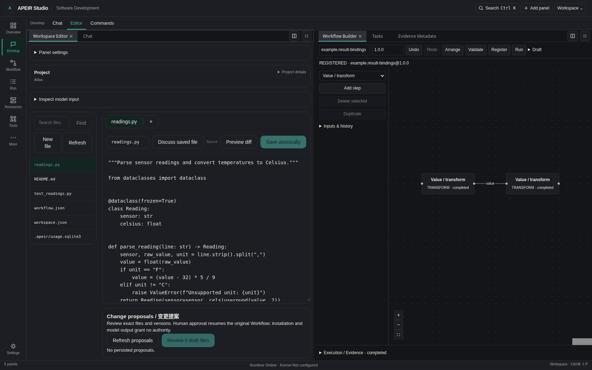

# APEIR

<!-- Compatibility anchors for existing documentation links. -->
<a name="apeir-studio"></a>
<a name="contributing"></a>
<a name="current-status"></a>
<a name="developer-platform"></a>
<a name="documentation"></a>
<a name="overview"></a>
<a name="quick-start"></a>
<a name="sdk--extensions"></a>
<a name="start-here"></a>
<a name="what-you-can-do"></a>


A local-first workspace for models, code and workflows.

APEIR is open source. Studio brings project files, conversations and visual workflows together.
Review changes before applying them, and keep a record of what ran.

[**⬇ Windows x64**](https://github.com/untrod/apeir/actions/runs/43549734683/artifacts/14097790424) ·
[**Windows ARM64**](https://github.com/untrod/apeir/actions/runs/43549737576/artifacts/14097648427) ·
[**Source Preview**](docs/operations/getting-started/QUICK_START.md#source-preview) ·
[**Quick Start**](docs/operations/getting-started/QUICK_START.md) ·
[**Documentation**](docs/README.md) · [简体中文](README.zh-CN.md)

**Windows:** choose x64 for Intel/AMD PCs or ARM64 for Windows on Arm.
[Install Setup](docs/operations/getting-started/INSTALL_WINDOWS.md#setup) · [Use Portable](docs/operations/getting-started/INSTALL_WINDOWS.md#portable) · [Verify SHA-256](docs/operations/getting-started/QUICK_START.md#download-metadata).
The download contains Setup and Portable. Version **0.1.0-rc1** is an unsigned
Developer Preview; downloading from Actions requires GitHub sign-in.



*APEIR Studio · source build.*

## What can I do?

| Task | Start here |
| --- | --- |
| Work on a project: browse files, review diffs and approve changes | [Studio guide](docs/operations/guides/USER_GUIDE.md#reviewing-workspace-changes) |
| Build a workflow: connect supported steps, run it and revisit the results | [Workflow guide](docs/operations/guides/WORKFLOW_GUIDE.md) |
| Make it your workspace: arrange panels and add a read-only widget | [UI Extension example](examples/studio_system_monitor/README.md) |

[Connect a cloud API or local model service](docs/operations/guides/PROVIDER_GUIDE.md)
when you need one. Files, layouts and model-free workflows are available without
a model account.

## Download and start

Windows users can download either architecture above, extract the bundle and
open its Setup installer. For a portable copy, extract the included Portable ZIP
and open `APEIR-Portable/APEIR.exe`. Keep the whole folder together.

Already using [GitHub CLI](https://cli.github.com/)? Download and verify the x64
installer in PowerShell:

```powershell
gh run download 43549734683 --repo untrod/apeir --name windows-x64-native-development-build --dir .\apeir-rc1-x64
if ($LASTEXITCODE -ne 0) { throw 'Download failed' }
$setup = '.\apeir-rc1-x64\APEIR_0.1.0-rc1_x64-setup.exe'
$expected = '8374139b89f070ab6e2982c8930055b3ff2fbf44d278756e32a538362e360a4e'
if ((Get-FileHash -LiteralPath $setup -Algorithm SHA256 -ErrorAction Stop).Hash -ne $expected) { throw 'SHA-256 mismatch' }
Write-Host 'Verified. Open the installer when ready.'
```

Use a new download directory. The command downloads and checks files; it does
not install them. [ARM64 instructions and checksums](docs/operations/getting-started/INSTALL_WINDOWS.md#download-with-github-cli).

Prefer another route?

- [**Source Preview**](docs/operations/getting-started/QUICK_START.md#source-preview):
  install the Python package and open the prebuilt Studio in a browser.
- [**Developer Setup**](docs/operations/getting-started/QUICK_START.md#developer-setup):
  run from a checkout with Python 3.10+ and Node.js 22.19+.

[Download metadata](docs/operations/getting-started/QUICK_START.md#download-metadata)
lists exact versions, hashes and retention dates. These downloads expire; a
public Release channel is not available yet.

## Develop and extend

[Developer Platform](docs/development/DEVELOPER_PLATFORM.md) ·
[Public Provider SDK](docs/development/PROVIDER_DEVELOPMENT.md) ·
[UI Extension SDK](docs/development/STUDIO_UI_EXTENSIONS.md) ·
[Examples](examples/README.md) · [API / CLI reference](docs/development/README.md)

The Provider SDK is beta. Studio extensions use declarative manifests rendered
by the host. See the [code map](docs/development/RUNTIME_MODULE_MAP.md#current-code-entry-points)
to find the CLI, Runtime, Studio and SDK entry points.

## Contribute

Start with [CONTRIBUTING](CONTRIBUTING.md). Report reproducible problems through
[Issues](https://github.com/untrod/apeir/issues); use [SECURITY](SECURITY.md) for
private vulnerability reports. [Architecture](docs/architecture/README.md) covers
execution, permissions and state ownership. APEIR Kernel is maintained in its
[own repository](https://github.com/untrod/apeir-kernel).

## Developer Preview status

Windows packages have passed build and service checks; the Windows 10 install,
upgrade and uninstall lifecycle is still under review. Model support depends on
the protocol and endpoint; running project tests requires a supported isolated
environment. See [current status](ROADMAP.md) and [known limitations](docs/acceptance/KNOWN_LIMITATIONS.md).

## License

[Apache-2.0](LICENSE) · [NOTICE](NOTICE) · [Third-party notices](THIRD_PARTY_NOTICES.md)
