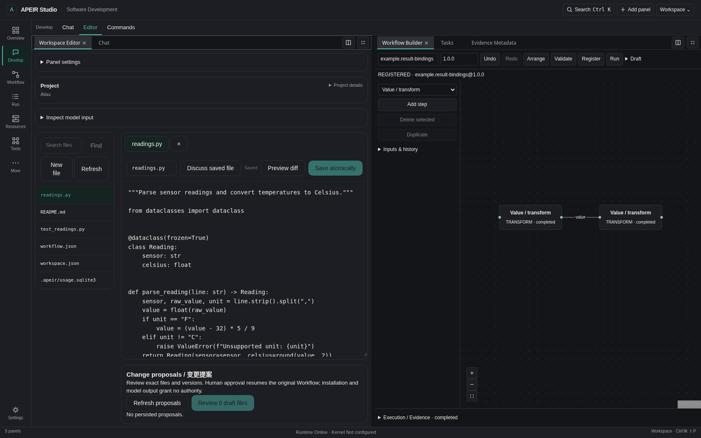

# APEIR

<!-- Compatibility anchors for existing documentation links. -->
<a name="apeir-studio"></a>
<a name="sdk-与扩展"></a>
<a name="从这里开始"></a>
<a name="可以完成什么"></a>
<a name="开发者平台"></a>
<a name="当前状态"></a>
<a name="快速开始"></a>
<a name="文档"></a>
<a name="概览"></a>

把模型、项目和工作流放进同一个工作台。

APEIR Studio 将项目文件、对话和可视化工作流连接起来。修改先看 Diff，操作经过审批，
执行结果随时可查。界面可以按自己的习惯组合，不必围着固定页面工作。

[**⬇ Windows x64**](https://github.com/untrod/apeir/actions/runs/43549734683/artifacts/14097790424) ·
[**Windows ARM64**](https://github.com/untrod/apeir/actions/runs/43549737576/artifacts/14097648427) ·
[**快速开始**](docs/operations/getting-started/QUICK_START.md) ·
[**文档**](docs/README.md) · [English](README.md)

Intel/AMD Windows 选 **x64**，Windows on Arm 选 **ARM64**。
下载包内同时提供安装版和 Portable。当前版本 **0.1.0-rc1** 为未签名开发预览版，
从 Actions 下载需要登录 GitHub。这是开发预览包，不是稳定发行版。



*APEIR Studio · 源码运行界面。*

## 可以做什么？

| 场景 | 从这里开始 |
| --- | --- |
| 阅读工程、审查多文件 Diff，确认后应用修改 | [项目与代码修改](docs/operations/guides/USER_GUIDE.md#reviewing-workspace-changes) |
| 连接工作流节点、执行任务，重新查看结果和历史 | [Workflow 指南](docs/operations/guides/WORKFLOW_GUIDE.md) |
| 组合窗口、保存布局，添加自己的只读组件 | [UI Extension 示例](examples/studio_system_monitor/README.md) |

需要模型时，再[连接云端 API 或本地模型服务](docs/operations/guides/PROVIDER_GUIDE.md)。
查看文件、调整布局和运行无模型工作流不需要模型账号。

## 下载与启动

下载对应架构的包并解压，打开其中的 **Setup 安装程序**。
不想安装，可以继续解压 **Portable ZIP**，运行 `APEIR-Portable/APEIR.exe`。
请保留整个目录，旁边的文件也是程序的一部分。

[安装与首次启动](docs/operations/getting-started/INSTALL_WINDOWS.md) ·
[版本与 SHA-256](docs/operations/getting-started/QUICK_START.md#download-metadata)

已安装并登录 [GitHub CLI](https://cli.github.com/) 的开发者，可以在 PowerShell
下载并校验 x64 安装程序：

```powershell
gh run download 43549734683 --repo untrod/apeir --name windows-x64-native-development-build --dir .\apeir-rc1-x64
if ($LASTEXITCODE -ne 0) { throw 'Download failed' }
$setup = '.\apeir-rc1-x64\APEIR_0.1.0-rc1_x64-setup.exe'
$expected = '8374139b89f070ab6e2982c8930055b3ff2fbf44d278756e32a538362e360a4e'
if ((Get-FileHash -LiteralPath $setup -Algorithm SHA256 -ErrorAction Stop).Hash -ne $expected) { throw 'SHA-256 mismatch' }
Write-Host 'Verified. Open the installer when ready.'
```

使用一个新的下载目录。这段命令只下载和校验，不自动安装。
[ARM64 命令及完整校验说明](docs/operations/getting-started/INSTALL_WINDOWS.md#download-with-github-cli)。
Actions 下载有保留期限；目前尚无公开 Release 下载渠道。

也可以选择：

- [**Source Preview**](docs/operations/getting-started/QUICK_START.md#source-preview)：
  安装 Python 包，用浏览器打开预构建的 Studio。
- [**Developer Setup**](docs/operations/getting-started/QUICK_START.md#developer-setup)：
  从源码开发，需要 Python 3.10+ 和 Node.js 22.19+。

## 开发与扩展

[开发者指南](docs/development/DEVELOPER_PLATFORM.md) ·
[Provider SDK](docs/development/PROVIDER_DEVELOPMENT.md) ·
[UI Extension SDK](docs/development/STUDIO_UI_EXTENSIONS.md) ·
[示例](examples/README.md) · [代码入口](docs/development/RUNTIME_MODULE_MAP.md#current-code-entry-points)

Provider SDK 处于 beta 阶段。Studio 扩展通过声明式配置描述界面，由宿主负责渲染。
CLI、Runtime、Studio 和 SDK 的入口都可以从代码导航中找到。

## 参与贡献

开发环境和 PR 流程见 [CONTRIBUTING](CONTRIBUTING.md)。普通问题请提交
[Issue](https://github.com/untrod/apeir/issues)，安全漏洞请按 [SECURITY](SECURITY.md) 私下报告。
[架构文档](docs/architecture/README.md)说明执行、权限和状态归属；
APEIR Kernel 维护在[独立仓库](https://github.com/untrod/apeir-kernel)。

## 预览版说明

Windows 包已通过构建和服务检查，Windows 10 的安装、升级、卸载仍在验证中。
模型支持取决于实际协议和服务端能力；运行项目测试还需要受支持的隔离环境。
详细状态见 [ROADMAP](ROADMAP.md) 和[已知限制](docs/acceptance/KNOWN_LIMITATIONS.md)。

## 许可证

[Apache-2.0](LICENSE) · [NOTICE](NOTICE) · [第三方声明](THIRD_PARTY_NOTICES.md)
