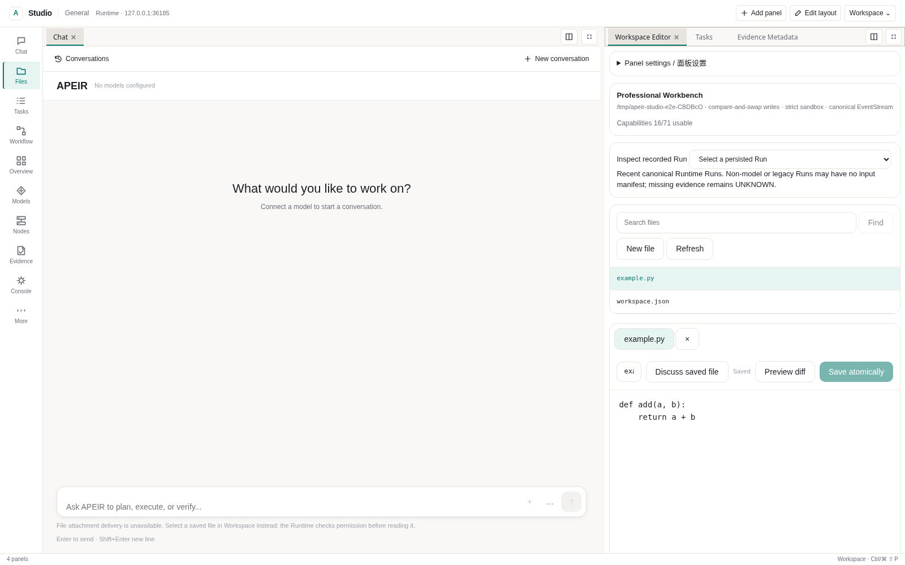
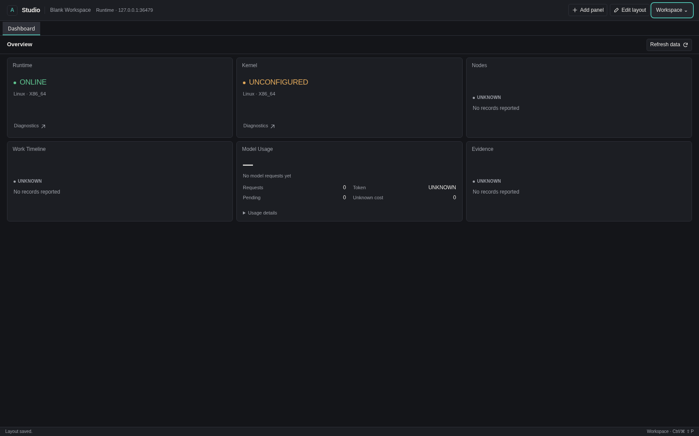
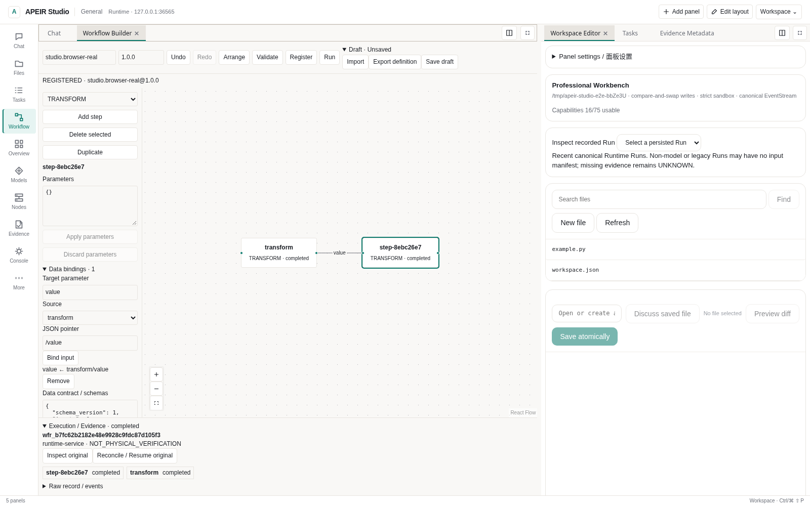
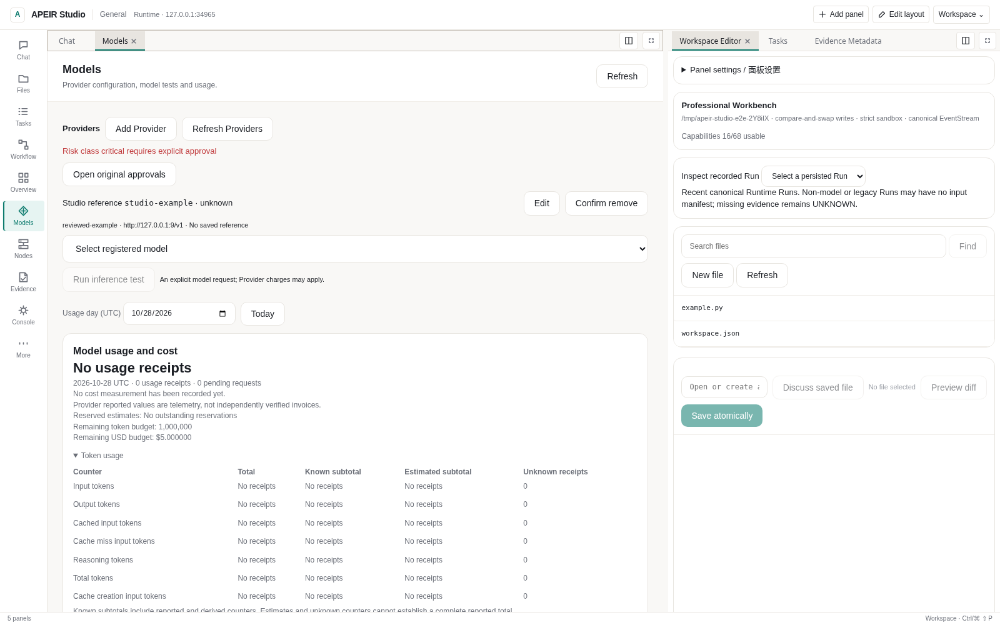
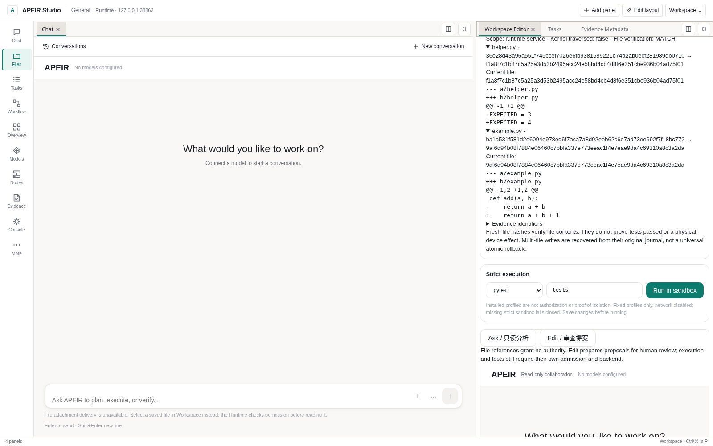
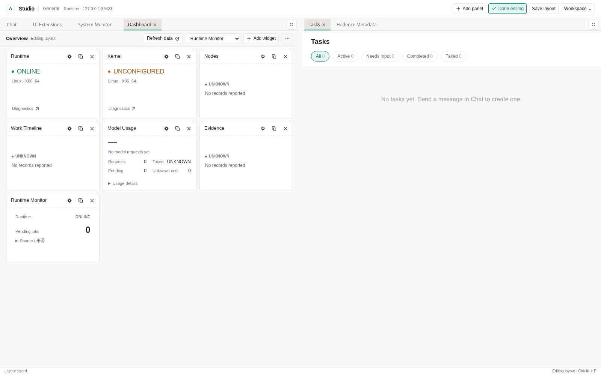

# Developer Platform / 开发者指南

Use APEIR Studio to work on a project, run a supported workflow, or build an
extension. The interface uses the same Runtime services as the CLI and public
API. Start with the task you want to do; the architecture can wait until you
need to extend it.

从实际任务开始：连接模型、打开工程、审查修改，或编排已有能力。
本页保留界面中的英文名称，方便对照中英文版本；完整安装命令在 Quick Start。

| Your goal | Start here |
| --- | --- |
| Download and launch | [Quick Start](../operations/getting-started/QUICK_START.md) |
| Arrange panels and dashboards | [Studio](#apeir-studio) |
| Connect an API or local model | [Models and Providers](#first-use-configuration-and-model-tests) |
| Watch model and tool activity | [Watching a request](#watching-a-request) |
| Check Tokens and cost | [Usage](#model-usage-and-cost) |
| Review a code change | [Workspace changes](#reviewing-workspace-changes) |
| Build a workflow | [Workflow Builder](#visual-workflow-builder) |
| Install a Skill | [Skills](#skills-and-tools) |
| Create a panel or widget | [UI Extension SDK](#declarative-ui-extension-sdk) |
| Write a Provider | [Public SDK](#source-sdk-onboarding) |

APEIR is the platform; **Studio** is its workspace, **Runtime** owns execution and
Governance, and **Kernel** is the separately pinned controlled-execution component.
[ROADMAP](../../ROADMAP.md) owns milestone status. Detailed historical tests and
failures belong in [Engineering Review](../acceptance/ENGINEERING_REVIEW.md).

## Surfaces

Studio combines existing views: Chat, Files, Workflow, Tasks, Models, Nodes,
Devices, Environment, Evidence, Usage, Documents and Simulation. Operations Console
provides the original governed controls. A visible panel does not make an
unconfigured Provider, disconnected Node or unsupported handler available.

### APEIR Studio

Install and connect using the [Quick Start](../operations/getting-started/QUICK_START.md).
For source development, use the same revision, Node.js 22.19+ and the existing scripts:

```bash
cd desktop
npm ci
npm run dev
```

Current Studio opens with Chat and Files in a new General layout. Existing saved
layouts are kept. If you see only a Dashboard, choose **Chat** or **Files** on
the left rail; **More / Add panel** opens the full searchable library.
**Workspace → Operations Console → Controller connection** configures the Runtime
address and protected service session token. That token is not a Provider API key.



| Action | How |
| --- | --- |
| Split or group panels | Drag a tab to an edge or another tab strip |
| Resize | Drag a splitter |
| Snap, maximize, restore or close | Use the panel title-bar arrangement menu |
| Maximize a group | Double-click its tab strip; **Show all panels** restores it |
| Find a panel | Ctrl/Cmd+Shift+P |
| Arrange Dashboard widgets | **Edit layout**, or Ctrl/Cmd+Alt+L |
| Save the layout | Automatic after a short delay, or Ctrl/Cmd+Alt+S |
| Dismiss a menu | Escape |

Panel movement does not execute Work. Closing a panel does not cancel its
background task. Floating OS windows remain disabled. Theme and language are in
**Workspace** and use the existing design system.

**Workspace → Layout library** saves named Global, Workspace, Template and
Dashboard arrangements. Load, duplicate, rename, export or remove an entry there.
Workspace entries use the actual Controller and directory; Dashboard entries
contain Dashboard panels only. Stale concurrent saves are rejected: reload the
library before editing again. Writes need browser Web Locks. Limits are16 entries
and 1 MiB. A rejected import or full library preserves earlier entries.

Version1 layouts and old Dashboard geometry remain compatible. Layout exports
contain presentation settings, not file contents, credentials, approvals or Work.
Resolve unsaved drafts and pending actions before replacing a layout. Rejected
saved bytes are retained until an explicit replacement. Editor drafts remain in
memory; saving a layout is not saving source files.

Add **Dashboard**, then enter **Edit layout** to add, move, resize, duplicate,
pause or configure widgets. **···** contains save/import/export/reset. Small
windows stack cards without rewriting saved coordinates. Widgets share existing
read subscriptions rather than creating a timer each. Node memory requires a
current trusted report; logical CPU capacity is not CPU utilization. Topology
uses exact reported Device-to-Node bindings. Missing data stays UNKNOWN, and
unsupported GPU/network/sensor metrics stay UNSUPPORTED.

### Watching a request

| Data / 数据 | Current behavior |
| --- | --- |
| Chat model/tool progress | Reads recorded Run events every 500 ms while active, plus request latency |
| Dashboard health and resource records | Shared five-second refresh while the corresponding data is in use |
| Model response text | Complete NKI response; no token-by-token production stream |
| Device effect | Requires the original receipt, independent observation and verification; a status card is not proof |

“正在处理”表示请求状态，不是对模型内部推理过程的转录。
事件断线不代表执行已停止；模型回复成功也不代表设备效果已验证。

Chat reads recorded Run events while a request is active (500 ms polling plus
request latency). Its activity card shows model iterations, tool names,
approval waits, artifacts and recorded failures. The latest activity remains
visible after the response until the next request or view change. Tasks,
Inspector and Evidence provide the underlying records. Tool completion is
distinct from independent verification; missing outcomes stay UNKNOWN.

Expand **Activity details** for recorded Provider/model identities, tool names,
Capability, scope and original invocation/approval/receipt references. Only
allowlisted metadata is displayed; raw tool arguments and private payloads stay
out of the card. **Execution activity** on a saved reply reads its original Run
without replaying execution. Live activity is bounded to 80 recent events;
historical inspection initially reads up to 200. A disconnected event reader
shows a reconnecting state: that does not establish that the backend task stopped.
Missing usage remains UNKNOWN; receipt-backed Usage remains the accounting view.

**Stop waiting** closes the local request and event reader. It does not confirm
Runtime cancellation or stop an already admitted charge. The message retains
**Execution activity** for the original Run; inspect that record before submitting
the task again. A lost response also retains its original activity link. While a
request is active, Enter preserves the next draft instead of dispatching an
overlapping request.
“停止等待”不等于后端已取消；请先核对原始记录，避免重复提交。

When an Agent request explicitly allows networking, `search_web` calls the same
governed `network.fetch`/Research service used by the **Research** tab. It accepts
a query and a bounded result count; it cannot change authorization or choose an
arbitrary transport. Research retains results, citations and snapshots under the
existing approval rules. Read-only Chat does not offer network tools. The existing
specified-URL fetch remains separate. Search HTML parsing and site availability
still depend on the actual source; a search result is not a verified claim.

The frozen NKI operation returns a complete response, so production Chat does
not offer token-by-token model output. Event progress remains available during
the wait. A complete extension-use ledger also remains pending: an installed or
loaded Skill does not establish that a model used it in a particular request.



These screenshots are real [source-browser evidence](https://github.com/untrod/apeir/actions/runs/40351274217)
at `f9e8301`, not installed Windows, live-model or physical-device qualification.
Browser Studio initializes the original EntityStore after authenticated health;
Work and original task summaries share the existing adapter. Missing progress or
unknown task states do not become successful tasks or enable controls.

### Visual Workflow Builder

Choose **Add panel → Workflow Builder**. The graph edits the same
WorkflowDefinition used by the Compiler, WorkflowStore and public CLI.

1. Add nodes, edit parameters and connect dependency handles. Shift-select,
   duplicate/delete, arrange, zoom and undo/redo are available.
2. **Apply parameters**, then **Validate** with the existing Compiler.
3. **Register** an immutable `workflow_id@version`. Change its version to change
   an already registered definition.
4. **Run** the reviewed version. Inspect its original Run, step outputs, digests
   and EventStream history. A lost response calls for history inspection, not
   another submission.

| Handler in the Studio API | Actual behavior |
| --- | --- |
| TRANSFORM | Returns `params.value` and the Run inputs |
| CONDITION | Compares `params.input` with `params.equals`; mismatch skips this node, without true/false branch ports |
| WAIT | Immediate barrier; not a timer |
| APPROVAL | Waits for a current authorized human on `workflow:RUN_ID:STEP_ID` |
| AGENT / CAPABILITY / CONNECTOR / COMMAND | UNSUPPORTED here; no execution host is bound |

Arrows express dependencies. In **Data bindings**, select a target parameter,
the Run inputs or a direct dependency, and a JSON pointer such as `/value`.
**Bind input** explicitly replaces that target's literal parameter. Bound edges
show their target names; remove a binding before removing its dependency.
The version 1 `data_bindings` step contract holds input references and optional
per-step `inputs_schema` / `outputs_schema`. **Apply parameters** applies the
parameter and contract drafts together. The backend Compiler validates both.

Bindings read original persisted results, not canvas labels. Missing paths or
input-type mismatches stop before downstream dispatch. An invalid result retains
its original output and checkpoint; it does not authorize another attempt or
implicit compensation. Changed evidence remains UNKNOWN. Digests and source
references appear in **Raw record / events** without copying resolved values
into the binding manifest. Resolved parameters and accepted results are bounded to 96 KiB.
There are no executable expressions or external schema fetches.

Use the [result-binding example](../../examples/hello_workflow/result-bindings.json)
with matching Runtime/Studio builds. Workflow catalog and CLI validation advertise
`data_bindings_versions: [1]`; older builds do not implement these fields.
The new UI does not run a bound definition against an older catalog.
Model/Agent consumers are still not bound here; account credentials alone do
not supply that missing execution host. Data contracts do not grant permission.
Unsupported imported steps retain their fields for inspection/export. Validation
alone does not establish an executable handler.

Optional `inputs_schema` applies before Run creation; `outputs_schema` validates
the final output object keyed by step ID. Empty schemas keep the existing
unrestricted-object contract. Installed JSON Schema Drafts 4/6/7/2019-09/2020-12
are supported, default 2020-12. References stay inside the submitted schema;
external schema/file fetching is disabled. Errors do not echo private values.
A result-schema failure preserves original completed steps and checkpoints,
reports FAILED and does not replay or automatically compensate them. Named
custom actions require a real host handler.

**Save draft** downloads a private version1 bundle with the definition and
separate canvas positions. **Export definition** omits coordinates and remains
CLI-compatible. **Import** confirms replacement of an unsaved draft. These files
may contain private parameters; review before sharing. Drafts survive panel
movement in memory, not browser restart. Export before closing. Controller
switching retires the draft rather than sending it to the new Controller.
Registered definitions and Run history persist through Runtime restart.

Mutation admission uses the actual server workspace, never a body-selected
target. Missing policy or human identity remains BLOCKED. Ordinary resume does
not approve anything. For an original Gate-bound approval, a trusted local owner
can inspect and approve it in the owning workspace:

```bash
apeir --no-intelligence approval show APPROVAL_ID --json
apeir --no-intelligence approval approve APPROVAL_ID
```

Replace the placeholder with the original pending ID, then retry only that
reviewed request. A service bearer cannot approve itself. Cancel/recover operates
on the original Run; UNKNOWN does not authorize replay of uncertain effects.
Records use `execution_scope=runtime-service`, not fabricated Kernel traversal.

Import [Hello Workflow](../../examples/hello_workflow/README.md) or validate the
same exported definition with the public CLI:

```bash
apeir --no-intelligence workflow validate workflow.json --json
```



### First-use configuration and model tests

The native wizard lets you choose a workspace, inspect Runtime/Kernel status and
configure a model or choose **Configure model later**. The latter keeps saved
Providers and makes no inference. A remote Controller retains its own workspace;
local initialization never manages that remote host. A pending connection or
workspace restart belongs to its original session, including A→B→A switches.

Use **Models** to add/edit a Provider, select its endpoint and exact vendor model
ID, save a credential reference, then explicitly **Test**. A display name or
Gateway ID is not a vendor model ID. Deletion updates the saved Registry and
current Gateway; it does not erase its separate credential or cancel an already
admitted call. Persistence failure preserves the preceding registration. If a
saved update cannot refresh the Gateway, execution is fenced: inspect the saved
record before retrying. Other running processes are not silently synchronized.
If the Model Registry is unavailable, model discovery reports an error. A healthy
Provider is not a substitute for a registered model or evidence of tool support.

Cloud and local Providers can coexist. Each model is selected by its Gateway
identity, scoped to its Provider (for example, `cloud/vendor/model` and
`workstation/vendor/model`), while the backend receives the original vendor
model ID. After upgrading an older configuration that used an unscoped vendor
ID containing `/`, select the model again from the current catalog; old ambiguous
IDs are not silently redirected. PRIVATE/OFFLINE routing excludes cloud
fallbacks. Automatic local detection uses exact loopback hosts; a display name,
URL path or similar-looking hostname does not establish locality. Qualified
remote inference nodes still need an explicit trusted host locality declaration.



*Actual source-browser session against a model-disabled Runtime. Configuration
survived reload; the denied removal left the original record intact. No model
request or external Provider call was made.*

| Configuration | Existing adapter path | What still needs verification |
| --- | --- | --- |
| OpenAI / compatible APIs, including compatible DeepSeek endpoints | Existing OpenAI-compatible client | Actual endpoint, model ID, authentication, parameters and supported calls |
| Anthropic Messages | Python adapter exists, but the frozen NKI Worker has no Messages backend; production calls are BLOCKED and the wizard disables this protocol | A governed protocol bridge and its qualification; adding a key alone will not enable it |
| Ollama / llama.cpp / vLLM server | Existing server adapters, including OpenAI-compatible endpoints | Running service, hardware, exact API and model capabilities |
| Native Gemini protocol | Not implemented in this configuration | Use only a genuinely compatible endpoint or keep unavailable |

These are adapter paths, **not an all-model compatibility list**. The presence of
an imported model file or a catalog entry does not start a local inference server.
Tool calling, vision, streaming, reasoning options and limits require actual
support; a model name cannot establish it.

The selected adapter's protocol takes precedence over its display name or port.
A genuine OpenAI-compatible proxy can serve Claude models; renaming an Anthropic
Messages endpoint cannot make it compatible. The locked Worker accepts automatic
tool selection; explicit `none`, `required` or a named `tool_choice` is rejected
before dispatch because that Worker cannot honor it. Existing reasoning and
structured-output parameters still depend on the selected endpoint's support.

| Result | Meaning |
| --- | --- |
| Configuration valid | References and fields validated; no inference |
| Endpoint metadata / ping | Endpoint probe; not authenticated inference |
| Model test completed | Actual Gateway request completed; inspect its request and Usage |
| UNKNOWN / missing Usage | Not measured; neither zero Tokens nor free inference |

Production calls use the existing Model Gateway/NKI. Missing Kernel or invalid
mapping fails closed with no direct SDK/HTTP fallback. Tests preserve original
request IDs after failure; inspect those records before another potentially
billed call. Cloud and local live inference remain PENDING without an explicitly
authorized account or running qualified local service.

Native local credentials use **Settings → Credentials** and the existing system
store; configuration keeps reference names. Browser Studio cannot save Provider
keys. Never put a key in layout JSON, ordinary configuration, logs or screenshots.
Provider URLs reject embedded credentials, queries and fragments. Root, `/v1`
and messages URLs normalize through the existing Anthropic configuration adapter;
normalization does not enable production Messages execution. Old saved records
need explicit review/resave rather than silent rewriting.

Select a model to lock that exact choice, including collaboration roles. An
unavailable selection reports an error instead of falling back. Leave selection
automatic to use the Router. Ordinary code and its tests use one development
path; ask explicitly for parallel agents when useful, or **single agent / 单模型**
to keep one path. No mode supplies tools or approval authority.

### Inspecting actual model input

Choose **Inspect model input** on a response or **Inspect active input** during a
request. **Recorded model input** opens a prior Run after restart without another
model call. Conversation, Run and Trace IDs keep their separate meanings.

The persisted content-free manifest records roles, counts, digests, tool
declarations, selected/omitted context and preceding tool-result metadata. A
successful file read identifies its relative source, selected lines and digest
from the same bytes. File text and tool arguments are not duplicated into these
metadata events. Failed reads are not reported as successful access.

A saved Workspace reference selects a path/SHA-256. **Send** requests a current
bounded read and separate Provider-transfer admission; selection alone sends no
bytes. Safe reading, current versions and permissions are rechecked at actual
Gateway attempts. Revocation blocks later transfer, though already sent bytes
cannot be recalled. Default configuration grants no sharing permission. Use the
host-owned [context permission policy](../operations/configuration/CONFIG_REFERENCE.md#context-permission-policy);
Windows requires its same-handle owner/protected-DACL contract. Unsupported safe
readers remain BLOCKED.

The manifest describes **application Gateway input**, not the Provider's final
HTTP envelope or proof of receipt. It is bounded to 256 messages, 64 tools and 128
sources; complete counts/digest remain available. The inspector reads at most
1,600 events with explicit truncation. Missing/legacy events stay UNKNOWN.
Collaborative worker/reviewer inputs are not covered by this Chat manifest.

The archived conversation excerpt is untrusted, incomplete history, not a
semantic summary or permission. Context snapshots preserve source/version,
owner, digests and omission reasons. Required objectives, plans and governance
items stay whole; an insufficient budget blocks dispatch. Work Harness separately
bounds prepared JSON to 96,000 characters and pauses before dispatch rather than
cutting a goal in half. Character and Token estimates are not measured usage.
Incremental snapshot APIs exist, but do not establish a qualified incremental
project-cache path throughout Chat.

Raw attachment/drop/paste delivery and Chat Node/privacy/per-request-budget
controls are unavailable in this path and are refused without clearing the
draft. Use admitted saved-file references. Configure the existing Provider and
budget policy before sending; disabled controls must not silently ignore input.

### Model usage and cost

**Model Lab / Usage** and the status bar read the same CostController journal via
`GET /api/v1/usage`. Change the UTC day and inspect original request/attempt/
receipt references. Controller changes clear old pending reads and billing data.
Reported, derived, estimated and unknown values, cache counters, pending requests
and reservations remain distinct. Missing usage/cost is UNKNOWN, not zero.
Reported usage is telemetry, not an independently verified invoice.

Budgets reserve before dispatch. A timeout/cancellation does not prove a request
was free, and cancellation cannot undo an already admitted charge. Parallel
children retain their own parent bindings, deadlines and unsettled accounting;
a missing response does not permit a new fan-out. A child cancellation is not
automatically parent cancellation. Positive aggregate limits cannot undo charges
from concurrent requests already dispatched.

**What reduces avoidable work today:** bounded context selection, deterministic
tool reads, one path for ordinary code/test requests and bounded archived-excerpt
loading. **What has not been demonstrated:** a general Token-saving percentage,
a real-model twenty-task cost comparison or complete semantic long-task
compression. Exact model choice stays locked; cheaper is not a substitute for
correct. See [measured scope](../acceptance/ENGINEERING_REVIEW.md#developer-intent-and-model-selection-correction--2026-10-27).

Pricing uses the existing host-selected `APEIR_MODEL_PRICING_FILE`. Unknown
prices stay unknown. Token-only policy requires both existing
`APEIR_MAX_DAILY_COST_USD` and `APEIR_MAX_RETRY_COST_USD` to be `none`; this read
view never changes policy or invents a vendor billing cap.

## Skills and tools

Use **Operations Console → Skills** for the canonical local and reviewed HTTPS
catalogs. Review the exact source, version, digest, requested capabilities and
compatibility, then install. Loading instructions, enabling, disabling and
uninstalling are separate operations. Current human permissions are required;
a service token alone is observe-only for these controls. Passive refresh does
not download remote catalogs.

Follow [Hello Skill](../../examples/hello_skill/README.md) for the runnable local
catalog example and the [acquisition contract](../architecture/SECURITY_CONTRACT.md#skillextension-acquisition-before-publication)
for reviewed HTTPS packages. Changed content needs review again. Provenance/CAS
integrity is not publisher certification. This is not an unrestricted public
marketplace or permission to run every third-party package.

An **Instruction Skill** supplies text. An **executable Tool/Provider** needs its
own supported implementation and current execution permission. Installed,
loaded, authorized and executed are four different states. The
[UI Extension SDK](#declarative-ui-extension-sdk) below adds declarative panels;
it does not turn a Skill into a Shell or grant device writes.

## Reviewing workspace changes

Open a real project in **Files / Operations → Workspace**. Read the relevant
files, edit drafts and choose **Review draft files**. The existing Proposal
Workflow records paths, original/replacement SHA-256, exact Diff and CAS refs.
Review them, obtain independent **Approve Once**, then resume the original
request. **Deny** changes no files. File versions and current permissions are
checked again before writing; changed files are not silently overwritten.

**Ask** is read-only. **Edit** exposes proposal tools only to an admitted model
and does not send unsaved editor contents automatically. The original Work,
Proposal and approval IDs remain bound. Missing Kernel/model stays explicit.
After a lost response, inspect the original proposal, actual files and evidence;
recovery observes the original attempt instead of writing again. Cancellation
fences later admission but cannot undo an effect already produced.



File MATCH means observed bytes match the reviewed proposal in runtime-service
scope. It does not mean tests ran or a physical effect was verified. Multi-file
recovery is not universal atomic rollback. Original bytes, replacement bytes and
per-file intentions remain available; a partially applied or uncertain write
cannot re-enter the model's write tool.

## Professional Workbench

Up to 12 editor tabs keep independent drafts, loaded digests, Diff and write
records in memory. Arrow keys, Home and End navigate tabs. Close/reopen to read
an externally changed file. Dirty tabs require explicit discard; pending approval
retains its original operation. Save/export protected state before changing
Controller or reloading. Layout preferences do not contain editor contents.

Workspace APIs share the existing `/api/v1/developer/workspace/` family:
`files`, `file`, `search`, `preview`, `write` and `run`; capability inspection is
`GET /api/v1/developer/capabilities`. Existing-file writes require the loaded
SHA-256 and reject stale edits with `NOUS_WORKSPACE_CONFLICT`. Successful single
replacements are atomic and retain recovery copies under
`.nous/backups/workbench/<run_id>/`.

Execution uses installed fixed profiles: `python`, `python-compile`, `pytest`,
`node` and `cargo-test`, with bounded workspace-relative targets, network denial,
time/output limits and ProcessSandbox admission. Inspect command, directory,
stdout/stderr, exit status and original Run/EventStream. Missing strict isolation
is BLOCKED; there is no unrestricted host-Shell fallback. Controlled Commands
and ProcessSession logs/stdin are not a complete interactive PTY or Git Studio.
Model-facing command/move/remove shortcuts without durable admission stay unavailable.

## Interactive project execution

The project cursor links conversation, project, original Work, Run and checkpoint.
A governed step-budget pause creates a recoverable checkpoint rather than a
success message. Durable AgentSession/Workflow stores exist; this does not prove
an interrupted in-memory Chat turn can automatically resume after restart.
Proposal and pure Workflow restart recovery have separate exercised paths.

## Scheduling boundary

Scheduling proposes placement within declared profiles, trust/privacy
constraints and lane limits. It cannot grant execution permission. Explicit
model choice is preserved. Manager/worker/reviewer outputs are proposals or
evidence, not independent approval.

## Experiment evidence

Experiments require actual paired baseline/candidate measurements. Sample size,
uncertainty and effect size accompany recorded results; missing data gets no
substitute report. Specifications/results live under `.nous/experiments/`.
`TestValidator` uses pytest outcome fields, not duration/warning counts. Exit 0
with only skips or missing pass evidence remains unverified. The scientific
reference also requires its qualified strict environment.

## Model evidence

Model Lab distinguishes declared capabilities, availability metadata and measured
observations. Zero samples is not zero quality. Context reads need a live
AuthorizationContext, matching actor/purpose and current Governance decision;
private data additionally needs its explicit owner and trusted human boundary.
A model profile, copied identity claim or successful health probe supplies none
of that authority.

Performance history belongs to the selected workspace. Its observation and
ranking endpoints do not use the legacy process-wide writer; rankings retain
their requested minimum sample count. `ModelObservationStore.record()` reports
unconfirmed persistence with `ModelObservationError`. Inspect the original
record; never repeat a Provider request to repair a telemetry failure. Unreadable
history is unavailable, not an empty success. These records are not the billing
ledger; [Usage](#model-usage-and-cost) remains the accounting view.

## Current boundary

Runtime state stays in the selected workspace, not the presentation layout.
Explicit `NOUS_WORKSPACE_ROOT` takes precedence over cwd discovery; ambiguous,
external, linked or corrupt selections fail rather than silently reading another
project. Database/sidecar path admission rejects links and nonregular files;
SQLite file URIs preserve literal filename characters. These local checks do not
qualify cross-host NFS/SMB state or defeat an OS owner replacing paths later.

Trusted handler registration may declare bounded retry safety or
`WorkflowHandlerPolicy(reconcile_started=True)` only for a handler that consults
original durable Work/effect evidence. Task/model data cannot supply that policy.
Consult [state ownership and recovery](../architecture/STATE_OWNERSHIP.md#failure-and-recovery)
and [execution paths](../architecture/EXECUTION_PATH.md) before writing an adapter.
Training, weight merging, arbitrary executable UI and complete Codex Harness
recovery are not qualified by this release. A visual graph editor is available
within the handler limits above.

## M3.6 public runtime SDK audit

The historical SDK audit and dated validation counts are preserved in
[Engineering Review](../acceptance/ENGINEERING_REVIEW.md#developer-sdk-qualification-archive--2026-10-06).
The public SDK reexports canonical contracts; it adds no executor or authority.

### Source SDK onboarding

Use [public SDK examples](../operations/getting-started/QUICK_START.md#public-sdk-examples)
and [Hello Provider](../../examples/hello_provider/README.md). Install the Provider
SDK from the same checkout. `nous_provider.runtime` exposes Work, Node,
ManagedDevice, Governance, Capability, Skill and Workflow contracts without
requiring consumers to import private Runtime modules. Legacy
`nous_provider.Device` still means a Kernel compute resource.

### CI scope and measured cost

Studio's checked-in browser tests start two owned model-disabled Runtime
processes and sandboxed Chromium. From `desktop`, with the Distribution installed
in the selected Python environment:

```bash
npx playwright install --with-deps chromium
npm run test:e2e
```

`APEIR_TEST_PYTHON` can select its absolute interpreter path. Tests cover real
HTTP/layout/draft/Controller and supported Workflow/extension paths; their output
is source-browser evidence, not installed Windows acceptance. The existing
[shared-Usage benchmark](../acceptance/ENGINEERING_REVIEW.md#shared-usage-transport-measurement--2026-10-24)
keeps its paired methodology and component-only limits.

Known documentation-only PRs use the existing narrow checks; code, mixed and
unknown paths receive broader regression. Main retains full platform checks.
Historical job-cost observations and unresolved timing evidence are in the
[SDK archive](../acceptance/ENGINEERING_REVIEW.md#developer-sdk-qualification-archive--2026-10-06).
A diagnostic workflow cannot satisfy a production/Core check by name alone.

### Packaging and compatibility

Controller, Node and CLI share `apeir-distribution`: `apeir-controller`,
`apeir-node` and `apeir`. Provider/NKI SDK wheels depend on the compatible
Distribution. Desktop remains the existing Tauri/Web package; native components
must match the lock. `nous_runtime`, `nous`, `NOUS_*` and `nous-node/1.0` remain
compatibility names. A compatible package does not establish Node trust.

### Conformance evidence

The existing CTK adds Work, Node, Device, Provider, Capability, Execution and
Evidence suites through `register_runtime_suites`. Missing targets report SKIP,
not certification. Contract probes inspect records and original evidence;
`validation_level=contract` does not imply execution or hardware acceptance.
An explicit governed execution probe is required to exercise effects.

### Supported development environment

Use an executable trusted CPython base interpreter, writable checkout and test
storage, named user and resolvable hostname. Keep HOME unchanged; tests use the
existing workspace configuration. Linux process-lifecycle containers need
`--init` or an equivalent reaper. The ProcessSession host reaps its own original
workload group; unconfirmed cleanup stays RECOVERY_REQUIRED. This is not permission
for escaped processes or a change to Kernel isolation.

### M3.6 validation record

Dated source, installed-wheel and contract results remain in the
[SDK archive](../acceptance/ENGINEERING_REVIEW.md#developer-sdk-qualification-archive--2026-10-06).
Current-head CI must qualify current changes; old green runs cannot do so.

### Canonical Work read correction

The [archived SDK evidence](../acceptance/ENGINEERING_REVIEW.md#developer-sdk-qualification-archive--2026-10-06)
retains the original startup/fresh-report correction and Windows failure logs.
Node readiness uses current authenticated connection/resource facts; a persisted
report alone does not make a reconnected Node ready.

## MCP access to the existing Runtime

Install the existing `mcp` extra and start the normal authenticated Runtime using
[the source quick start](../operations/getting-started/QUICK_START.md). A host operator supplies
its existing service credential to the stdio bridge through
`APEIR_MCP_API_TOKEN`; never put it in a prompt, tool argument, checked-in MCP
configuration or command argument. The bridge delegates that credential only to
one host-configured Controller origin:

```bash
apeir extension serve-mcp --runtime-url http://127.0.0.1:8770
```

Remote Controller origins require HTTPS and the platform certificate trust
store. Plain HTTP is limited to numeric loopback; redirects, URL credentials,
query strings and alternate paths are rejected. The official MCP SDK owns the
stdio protocol. The bridge has a whole-call HTTP deadline and closes its request on cancellation.
It owns no execution worker, state database, approval,
trust store or verification authority. It never automatically retries HTTP calls.
The Controller authenticates every call to its existing API before dispatch.

All tools require an explicit current PermissionEngine rule for the authenticated
service subject, exact tool action and resource below. Missing policy fails
closed; discovering a tool does not grant it. Configure permissions through the
existing host-owned Governance policy, not through MCP or model output. The
credential remains protected bridge-process material: these rules scope MCP
calls, not every legacy API that the same service credential could access.
Exposing that credential or an unrestricted host terminal to an external agent
is not qualified by this interface.

| Tool | Input | Permission resource / original owner |
| --- | --- | --- |
| `apeir.nodes.list` | none | `workspace:<SHA-256 of canonical workspace path>`; existing Controller facts, never invented online state |
| `apeir.devices.inspect` | `device_id` | `device:<id>`; existing Reality DeviceRegistry |
| `apeir.work.submit` | `objective`, `idempotency_key` | workspace resource; original WorkSupervisor, read-only tool profile, maximum 8 iterations |
| `apeir.work.status` | `run_id`, optional `owner` | `work:<id>` for default `work-harness`, `distributed-work:<id>` for explicit `distributed` |
| `apeir.evidence.read` | same as status | original checkpoint/EventStream or DistributedWorkStore evidence references; never another verifier |

Work submission additionally passes the **original** `runtime.execute` API
Governance Gate. A required human approval remains pending in the existing
approval UI/CLI; no MCP approval tool exists. An authenticated retry of the same
scoped key and identical effective inputs returns the original Run without a
new model/tool invocation or a new approval. Changed inputs, damaged bindings or
interrupted initialization fail closed. This fence is in the existing verified
checkpoint store and survives ordinary retention; it is not a new Work registry.
Missing HTTP responses or client cancellation do not imply failure of the
original Work. Query its status/evidence before any explicit recovery action.

Results are centrally redacted and bounded to 1 MiB. Evidence exposes original
records/references; execution success, receipt, file checksum and physical MATCH
remain distinct. `owner` never falls back to another Work system. This first
interface supplies no arbitrary host command, file transfer, approval, grant or
physical operation API. A Work's own tools continue through their existing
permissions and execution boundaries. Selected-file Chat disclosure qualification
does not automatically qualify every Work Harness model-input path.

Reproduce the stdio/HTTP, scope, negative-security, approval and original-request
recovery contracts:

```bash
python -m pytest -q tests/extensions/test_runtime_mcp_server.py tests/work/test_work_submission.py
```

The official Codex App Server 0.163.0 was separately exercised with direct MCP
calls: thread start, tool discovery, current Node projection, original Distributed
Work query and a new Work stopped at human approval. **No model Turn ran.** This
is MCP interoperability evidence, not complete authenticated Codex Harness,
workspace-isolation, paid usage, cancellation or recovery qualification. Official
CLI authentication metadata was available, but scoped filesystem/credential and
native tool admission must be qualified before enabling a model Turn; an
instruction prompt is not that boundary.

## Declarative UI Extension SDK

Studio UI contributions use the existing Native Extension IR, ExtensionRegistry,
CAS and Governance. The data-only child contract is
[`apeir.studio-ui/v1`](../../spec/extensions/v1/studio-ui.schema.json), under
`metadata.apeir_studio`. Existing non-UI packages and version-1 layouts retain
their contracts. The [System Monitor example](../../examples/studio_system_monitor/README.md)
contains a standalone public HTTP client and an actual Panel/Widget manifest.
Copy it outside the repository; developing a standard declarative contribution
requires no Core change or private Python import.

| SDK capability | Public contract |
| --- | --- |
| Register Panel / Widget | Manifest `contributions` with `kind: panel/widget`; stable local ID, title and validated `view` |
| Read allowed data | `GET /api/v1/studio/extensions/data` with `component_type`, `expected_digest`, `source=runtime.status` |
| Read allowed events | `GET /api/v1/studio/extensions/events` with component/digest; bounded declared lifecycle metadata from the original bus |
| Request governed action | `POST /api/v1/studio/extensions/action`: original component/digest, declared `workflow.run`, original `idempotency_key` |
| Presentation settings | Existing Panel layout and Dashboard title/position/size/pause configuration; normal version-1 import/export |
| Review / install | `POST .../review` then `POST .../install`, reviewed source digest and expected previous digest |
| Enable / disable / remove | `POST .../configure` or `.../remove`, binding original identity/version/digest |
| Shared Studio projection | `GET /api/v1/studio/extensions`; one existing visibility-aware read coordinator, not a timer per Widget |

The example client exercises these exact endpoints. API authentication, current
workspace permissions and, for mutations, the existing Gate are mandatory.
Current authenticated humans additionally use the existing exact-body nonce.
A service request can wait for a separate human approval; it cannot approve itself.
Raw manifest text is not copied into the governance proposal: its reviewed digest
binds the source bytes. Source content is retained in the existing CAS with the
existing package verification and provenance records. Publisher text and an
import compatibility level are not a signature or certification.

Views support escaped text, metric, status, table, bounded current-session chart,
stack and one optional governed action per contribution. There is no HTML render,
JavaScript expression, module URL, iframe code injection, credential, Tauri IPC or
unrestricted file/network/process access. The shared catalog consumer admits up to 5 MiB (64 packages of at most 64 KiB
of presentation metadata plus record envelopes), without widening view or action
schemas. This avoids rejecting valid multi-package catalogs at the original
1 MiB client limit. Data is restricted to the host's sanitized
Runtime status fields and declared lifecycle event metadata. Unavailable fields
remain UNKNOWN. Chart samples are transient display history, not persisted evidence.

Install and enable are separate. Updates require a new immutable version and
start disabled; stale review bindings cannot overwrite another installation.
Disable/revoke/remove denies new component access. Existing uncertain Work remains
in its original Runtime history. Missing/uninstalled contributions keep inert layout
slots. Moving or loading a panel never starts an action. After a lost mutation
response, refresh and inspect original state; the UI does not replay it automatically.
The host's package writer fence and CAS pins are reused; no second registry,
permission database or event bus is created.

The first acquisition profile imports bounded native JSON manifests, not arbitrary
ZIP/JavaScript applications. Dependencies are checked against already verified
installed packages, without fetching or granting them. Only bound pure Workflow
handlers may be requested through the optional action; other hosts are explicitly
unavailable. Executable custom UI remains BLOCKED until target-platform isolation
is independently demonstrated. Neither this SDK nor browser acceptance qualifies
Windows native installation, real model accounts or physical effects.


