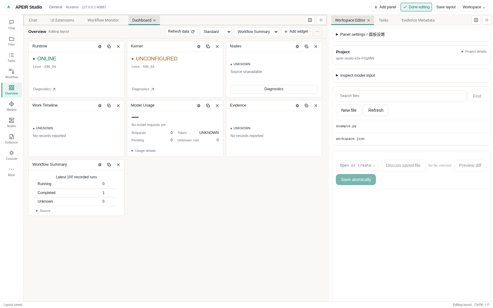
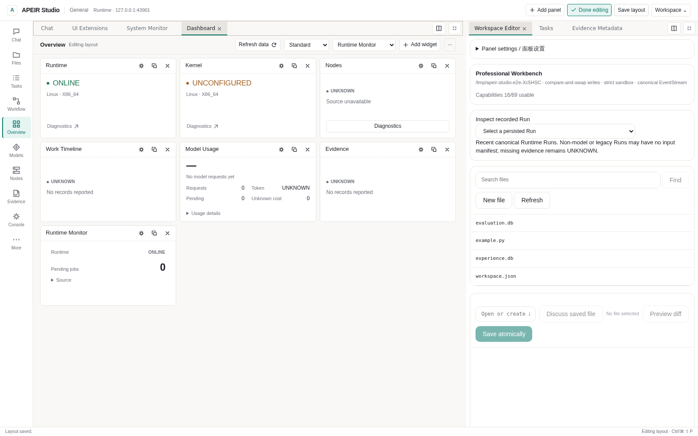

# Create a declarative Studio widget

Start with the [System Monitor example](../../examples/studio_system_monitor/README.md).
It uses a versioned data-only manifest and the public HTTP interface. You can
review, install, enable and remove it without changing APEIR Core.
A running authenticated Runtime and independent approval of lifecycle mutations
are required. No model account or arbitrary JavaScript is involved.

## Make a small change

1. Copy `examples/studio_system_monitor` outside the checkout. Keep its public
   `monitor_client.py` and `nous.extension.json` together.
2. In the manifest, choose your `extension_id`, version and description. Under
   `metadata.apeir_studio.contributions`, keep a `kind: widget` contribution with
   a stable local `id`, title and declared `runtime.status` subscription.
3. Modify a label or use one of the example's existing allowed fields, such as
   `running` or `jobs_pending`. `view.kind` selects a host-rendered status, metric,
   table or chart; it is not an executable expression.
4. Review/install the exact manifest bytes, independently approve that original
   request, then separately enable it. The [example](../../examples/studio_system_monitor/README.md)
   contains the tested UI and standard-library client commands.
5. Add the Widget in Dashboard layout editing, save, disable it and confirm its
   new reads are refused. Use a new version for changed bytes; an update starts
   disabled. Uninstall leaves a Missing Extension slot instead of deleting layout.

The unchanged example was exercised through the public HTTP API outside the
checkout. Read-only status and lifecycle operations worked; unauthorized,
disabled, undeclared and conflicting-version requests were refused. No cloud
model, Shell, physical device or arbitrary JavaScript was involved.

## Host compatibility

The wire schema remains `apeir.studio-ui/v1`. Existing status-only manifests and
version-1 layouts remain readable. The host now advertises `contract` metadata
through `GET /api/v1/studio/extensions`; the standalone client prints it with:

```bash
python monitor_client.py contract
```

| Package | Required host support | Behavior on older hosts |
| --- | --- | --- |
| Original System Monitor | Existing v1 status/lifecycle interface | Existing review, read and lifecycle commands remain compatible |
| Workflow Monitor | `data.workflow.summary` | Review/install is refused when the host lacks this feature |
| Unknown schema or required feature | Unsupported | Refused before installation; no guessed fallback |

Declare new requirements as `metadata.apeir_studio.requires`, for example
`["data.workflow.summary"]`. Feature names describe implemented wire support,
not availability, trust or a permission grant. Installation still requires a
review of the exact bytes and independent approval. Keep the matching source
revision for beta SDK development; a shared `0.1.0-rc1` display version alone does
not prove that an older native package implements a new feature.

## Workflow Monitor

The existing [example directory](../../examples/studio_system_monitor/README.md#workflow-monitor)
now includes `workflow-monitor.extension.json`, using the same public client.
Copy it outside the checkout with `monitor_client.py`; no private imports or Core
patches are needed. It contributes a Panel and a Dashboard Widget.

`workflow.summary` exposes state counts from the **latest 100 recorded runs in
the current workspace**. It calls the original Workflow catalog and its existing
resource admission. The actor needs current `workspace.read` permission for both
the extension registry and `.nous/workflows.db`. Declaring
`workflow.summary.read` does not supply either permission.

Values contain counts and a sample limit. Workflow names, Run IDs, input/output
content, approvals and credentials are excluded. `UNKNOWN` stays its own state;
completed runs are logical outcomes, not independent effect verification. Counts
are not lifetime totals, progress percentages or time estimates.

The shared Studio projection reads this source once for all enabled subscribed
components. It adds no per-Widget timer. A denied source is `BLOCKED`; a failed
read is `UNAVAILABLE`, with null values. Other status widgets remain usable.
Disable/remove prevents new reads; controller switching and Runtime restart
continue through the existing connection guards, Registry and Workflow history.



*Workflow Monitor displays read-only counts from the connected Runtime.*

## Declarative UI Extension SDK

Studio UI contributions use the existing Native Extension IR, ExtensionRegistry,
CAS and Governance. The data-only child contract is
[`apeir.studio-ui/v1`](../../spec/extensions/v1/studio-ui.schema.json), under
`metadata.apeir_studio`. Existing non-UI packages and version-1 layouts retain
their contracts. The [System Monitor example](../../examples/studio_system_monitor/README.md)
contains a standalone public HTTP client and an actual Panel/Widget manifest.
Copy it outside the repository; developing a standard declarative contribution
requires no Core change or private Python import.

| SDK capability | Public contract |
| --- | --- |
| Register Panel / Widget | Manifest `contributions` with `kind: panel/widget`; stable local ID, title and validated `view` |
| Read allowed data | `GET /api/v1/studio/extensions/data` with `component_type`, `expected_digest`, `source=runtime.status/workflow.summary` |
| Read allowed events | `GET /api/v1/studio/extensions/events` with component/digest; bounded declared lifecycle metadata from the original bus |
| Request governed action | `POST /api/v1/studio/extensions/action`: original component/digest, declared `workflow.run`, original `idempotency_key` |
| Presentation settings | Existing Panel layout and Dashboard title/position/size/pause configuration; normal version-1 import/export |
| Review / install | `POST .../review` then `POST .../install`, reviewed source digest and expected previous digest |
| Enable / disable / remove | `POST .../configure` or `.../remove`, binding original identity/version/digest |
| Shared Studio projection | `GET /api/v1/studio/extensions`; one existing visibility-aware read coordinator, not a timer per Widget |

The example client exercises these exact endpoints. API authentication, current
workspace permissions and, for mutations, the existing Gate are mandatory.
Current authenticated humans additionally use the existing exact-body nonce.
A service request can wait for a separate human approval; it cannot approve itself.
Raw manifest text is not copied into the governance proposal: its reviewed digest
binds the source bytes. Source content is retained in the existing CAS with the
existing package verification and provenance records. Publisher text and an
import compatibility level are not a signature or certification.

Views support escaped text, metric, status, table, bounded current-session chart,
stack and one optional governed action per contribution. There is no HTML render,
JavaScript expression, module URL, iframe code injection, credential, Tauri IPC or
unrestricted file/network/process access. The shared catalog consumer admits up to 5 MiB (64 packages of at most 64 KiB
of presentation metadata plus record envelopes), without widening view or action
schemas. This avoids rejecting valid multi-package catalogs at the original
1 MiB client limit. Data is restricted to the host's sanitized
Runtime status fields, permission-admitted Workflow state counts and declared
lifecycle event metadata. Unavailable fields
remain UNKNOWN. Chart samples are transient display history, not persisted evidence.

Install and enable are separate. Updates require a new immutable version and
start disabled; stale review bindings cannot overwrite another installation.
Disable/revoke/remove denies new component access. Existing uncertain Work remains
in its original Runtime history. Missing/uninstalled contributions keep inert layout
slots. Moving or loading a panel never starts an action. After a lost mutation
response, refresh and inspect original state; the UI does not replay it automatically.
The host's package writer fence and CAS pins are reused; no second registry,
permission database or event bus is created.

The first acquisition profile imports bounded native JSON manifests, not arbitrary
ZIP/JavaScript applications. Dependencies are checked against already verified
installed packages, without fetching or granting them. Only bound pure Workflow
handlers may be requested through the optional action; other hosts are explicitly
unavailable. Executable custom UI remains BLOCKED until target-platform isolation
is independently demonstrated. Neither this SDK nor browser acceptance qualifies
Windows native installation, real model accounts or physical effects.


