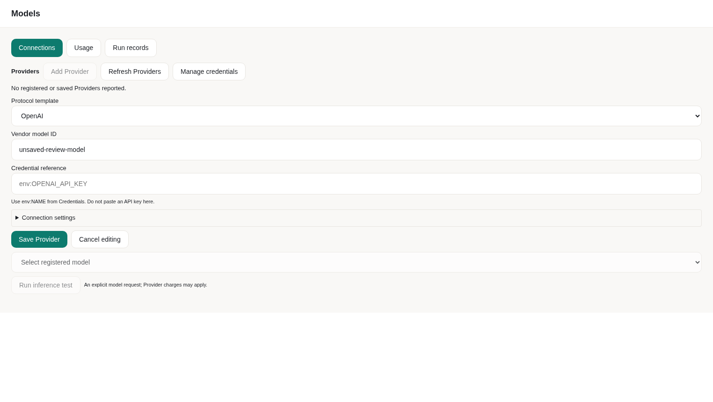

# Models and Providers

Configure an existing cloud API or local inference service, then deliberately
test a registered model. Local and cloud profiles can coexist; configuration,
endpoint reachability, inference and tool support are separate checks.

## Configure

1. Open **Models → Connections** in Studio and choose **Add Provider**. Select an implemented
   protocol; its preset supplies the endpoint. **Connection settings** contains
   the endpoint, display name and Provider ID; compatible custom endpoints expand
   this section automatically.
2. Enter the exact vendor model ID and, when required, a credential reference.
   The display name is not the backend model ID. Save the profile, then select a
   registered local or API model. Ollama connects to an already-running service;
   its optional credential field lives in Connection settings.
3. Check the saved configuration. Choose **Test** only when a model request is
   intended and its account/budget use is authorized.

You can choose **Configure model later** in the native wizard. It preserves
saved profiles and makes no inference. A Runtime started with
`--no-intelligence` cannot infer after saving a profile; restart in normal mode
with the required authenticated Kernel before a production model test.

Choose **Manage credentials** from Models to open the existing native credential
manager. It requires the desktop application connected to its own local Runtime;
a remote Controller cannot manage this computer’s keys. The shared **Settings →
Models & credentials** uses the same manager. Save a key there, then enter a reference such as
`env:DEEPSEEK_API_KEY` in the Provider form. The field shows valid references, masks invalid input,
and rejects raw keys before any configuration request. Browser Studio does not
save keys; remote services use their own host’s secure backend. Saving or removing
a local credential restarts Runtime. Save or cancel drafts in other panels first;
Studio blocks the restart while those drafts remain. Switching a new profile’s
protocol template clears its previous model ID and credential reference; changing
the interface language keeps the draft.

**中文提示：** 先在“管理凭据”中保存密钥，再填写 `env:名称`。模型 ID 应使用
服务商实际接受的标识，例如 `deepseek-chat`，不要填写显示名称或随意编号。
保存配置不发起推理；“运行推理测试”是一次明确的模型调用，可能产生费用。
“连接配置”“用量”“运行记录”分开展示，切换分类保留未保存草稿。
Never put a key in layout JSON, ordinary configuration, source or a screenshot.

```bash
apeir provider add
apeir --no-intelligence provider list
apeir --no-intelligence provider show PROVIDER_ID
apeir --no-intelligence provider status
apeir --no-intelligence provider doctor
```

Replace `PROVIDER_ID` with the saved identity. `provider quick` is an existing
shortcut with process-scoped credentials; those values do not survive restart.

Editing a profile blocks removal and inference tests until the edit is saved or
cancelled. A test always uses saved configuration. Refreshing Provider metadata
retires the old test badge; original request and usage records remain in Runtime.
Reported Provider status is not proof of endpoint authentication or inference.
The result names its actual tested model. Missing usage and cost stay UNKNOWN.

## Workspace and connection

The native wizard selects the local workspace and can skip model setup. A remote
Controller retains its own workspace; local initialization does not manage that
remote host. Pending connection/restart results belong to their original session,
including A→B→A switches. Changing Controller retires the previous identity and
requests; do not reuse its credential or approvals.



*Actual Linux Chromium source session, 1600×1000 viewport; the image captures
the Models panel. The unsaved model ID is a fixture, and no inference was
requested. Configuration, usage and run records have separate tabs.*

## Cloud and local services

| Protocol/service | Current boundary |
| --- | --- |
| OpenAI-compatible cloud API | Requires its actual supported endpoint, model ID, authentication and parameters |
| Compatible DeepSeek endpoint | Use the implemented compatible protocol; the vendor name alone proves nothing |
| Ollama / llama.cpp / vLLM service | Start the actual local service separately; verify its protocol, model and hardware |
| Anthropic Messages | Production calls are BLOCKED: the frozen NKI Worker has no Messages backend; the wizard disables that protocol |
| Claude behind a compatible proxy | Only a genuinely implemented OpenAI-compatible proxy can use that adapter |
| Native Gemini protocol | Not implemented in this configuration; keep unavailable or use a genuinely supported compatible endpoint |

These are adapter paths, not an all-model compatibility list. Installing a model
file does not start a server. Tool calling, vision, reasoning options, context
limits and streaming need actual endpoint support. The selected protocol takes
precedence over the display name or port.

Provider URLs reject embedded credentials, queries and fragments. The existing
Anthropic configuration adapter can normalize root, `/v1` and messages URLs;
that normalization does not supply a production Messages backend. Review and
resave older profiles explicitly rather than silently rewriting them.

### Model identities and local routing

Gateway IDs are scoped to the Provider: for example, `cloud/vendor/model` and
`workstation/vendor/model`. The backend receives its original vendor ID. After
upgrading an old slash-containing unscoped ID, reselect it from the current
catalog; ambiguous identities are not silently redirected.

Automatic local detection accepts exact loopback hosts. A profile called
“local”, a URL path or a similar-looking hostname does not establish locality.
A trusted remote inference node needs an explicit host locality declaration.
PRIVATE/OFFLINE routing does not silently switch to cloud services.

An explicit selected model remains locked, including collaboration roles.
Unavailable selection reports an error. Automatic routing uses the existing
Router; neither routing nor agent collaboration supplies execution permission.

## Test deliberately

```bash
apeir provider ping PROVIDER_ID --json
```

This checks reachability; it does not prove authenticated inference.

```bash
apeir provider test PROVIDER_ID --json
```

This sends a minimal request and can incur cost. It requires the configured
Gateway/NKI path, actual credentials, model and current budget authorization.
There is no direct SDK fallback. Inspect its original response and usage.

| State | Meaning |
| --- | --- |
| UNCONFIGURED | Required configuration or credential reference is missing |
| BLOCKED | A required execution boundary, protocol, permission or prerequisite is unavailable |
| Endpoint reachable | Network check passed; the model has not necessarily run |
| Model completed | Original inference completed; inspect the response and usage |
| UNKNOWN usage/cost | Not measured, not zero and not free |

A healthy Provider does not replace a registered model or prove tool support.
Actual cloud/local account qualification remains separate from deterministic
software tests. The current preview has no general all-model PASS.

## Change or recover a profile

Saved edits update the existing Registry and Gateway. Failed persistence retains
the previous record; a failed Gateway refresh fences execution until the saved
state is inspected. Other running processes are not silently synchronized.
Deleting a profile neither deletes its separate credential nor cancels a call
already admitted.

After a timeout, lost response or accounting error, inspect the original request
before another potentially billed call. Missing response does not establish
that the Provider did no work. Keep the original request/usage identity; do not
repeat inference to repair telemetry.

Loading, capacity queues and Kernel transport share the original request's
remaining time. A cancelled load or unload is failed, not ready; inspect its
resource state before an explicit recovery. Cancelling one waiting caller does
not cancel another caller's shared load. Unloading a model does not prove that an
already-dispatched remote request stopped or incurred no cost.

## See also

[Context, Tokens and cost](CONTEXT_AND_USAGE.md) ·
[Recorded activity](USER_GUIDE.md#watching-a-request) ·
[Provider SDK development](../../development/PROVIDER_DEVELOPMENT.md)

`nous provider` remains a compatibility alias for `apeir provider`.
