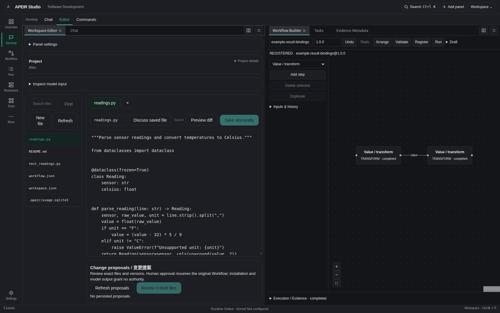
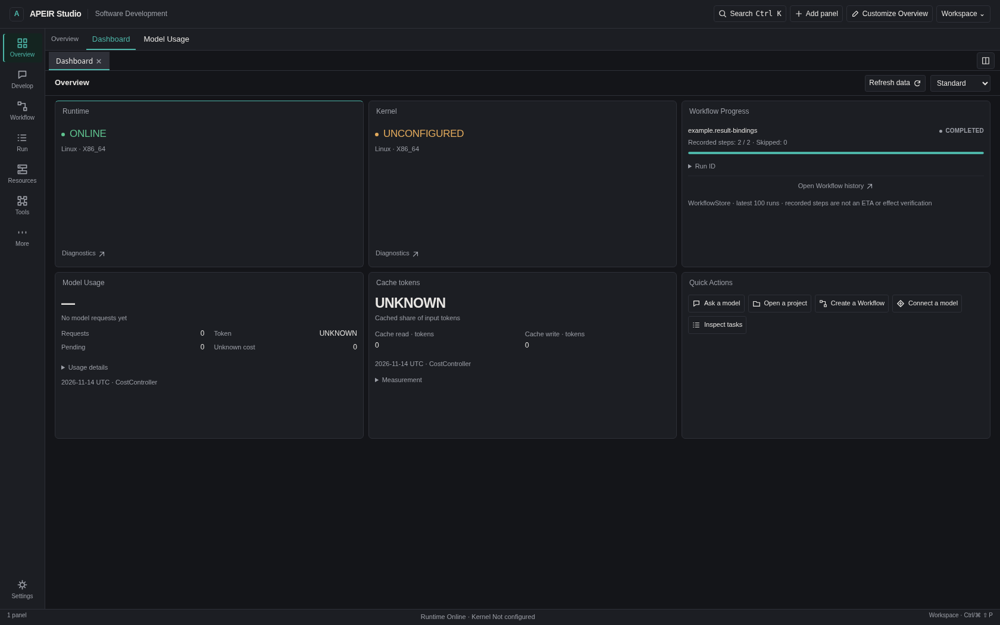
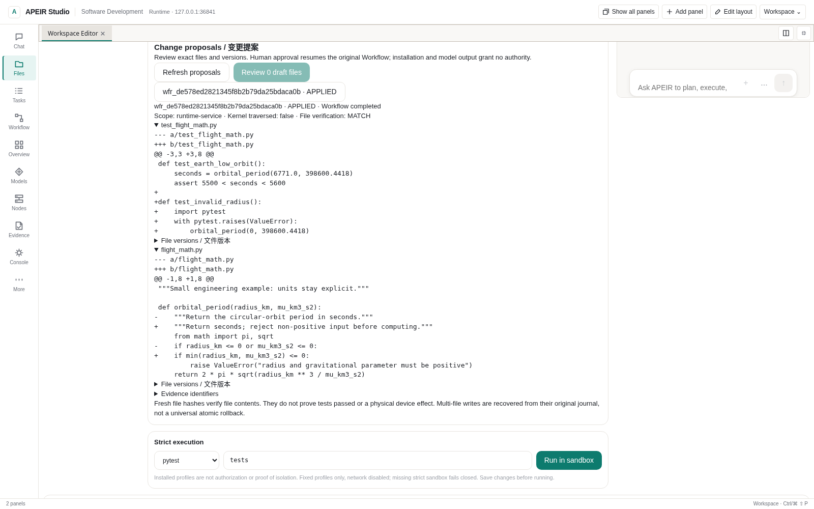

# Use APEIR Studio

<!-- Compatibility anchors for existing documentation links. -->
<a name="apeir-runtime--user-guide"></a>


Open a project, arrange the workspace and inspect an original task. Start the
Runtime and Studio through [Quick Start](../getting-started/QUICK_START.md).
A model account is optional for file browsing and supported pure workflows.

## Your first task

1. Connect to the Runtime that owns your selected workspace. Check its actual
   Runtime/Kernel status; an unconfigured model is not a failed installation.
2. Open **Files**, select a project file and read it in the editor.
3. Review a draft through [workspace changes](#reviewing-workspace-changes), or
   import [Hello Workflow](../../../examples/hello_workflow/README.md).
4. Open **Tasks**, **Evidence** or the original Run to inspect its records.
   Keep that identity when reconnecting or recovering a lost response.

For a model request, first [configure a Provider](PROVIDER_GUIDE.md).
Model output and tool availability do not grant permission to modify files.

## APEIR Studio

Install and connect using the [Quick Start](../getting-started/QUICK_START.md).
For source development, use the same revision, Node.js 22.19+ and the existing scripts:

```bash
cd desktop
npm ci
npm run dev
```

Current Studio opens with Chat and Files in a new General layout. Empty Chat
offers **Connect a model**, **Open project files** and **Open Workflow**; these
open existing panels without submitting a task. Existing saved
layouts are kept. If you see only a Dashboard, choose **Chat** or **Files** on
the left rail; **More / Add panel** opens the full searchable library.
**Workspace → Operations Console → Controller connection** configures the Runtime
address and protected service session token. That token is not a Provider API key.



| Action | How |
| --- | --- |
| Split or group panels | Drag a tab to an edge or another tab strip |
| Resize | Drag a splitter |
| Snap, maximize, restore or close | Use the panel title-bar arrangement menu |
| Maximize a group | Double-click its tab strip; **Show all panels** restores it |
| Find a panel | Ctrl/Cmd+Shift+P |
| Arrange Dashboard widgets | **Edit layout**, or Ctrl/Cmd+Alt+L |
| Save the layout | Automatic after a short delay, or Ctrl/Cmd+Alt+S |
| Dismiss a menu | Escape |

Panel movement does not execute Work. Closing a panel does not cancel its
background task. Floating OS windows remain disabled. Theme and language are in
**Workspace** and use the existing design system.

**Workspace → Layout library** saves named Global, Workspace, Template and
Dashboard arrangements. Load, duplicate, rename, export or remove an entry there.
Workspace entries use the actual Controller and directory; Dashboard entries
contain Dashboard panels only. Stale concurrent saves are rejected: reload the
library before editing again. Writes need browser Web Locks. Limits are16 entries
and 1 MiB. A rejected import or full library preserves earlier entries.

Version1 layouts and old Dashboard geometry remain compatible. Layout exports
contain presentation settings, not file contents, credentials, approvals or Work.
Resolve unsaved drafts and pending actions before replacing a layout. Rejected
saved bytes are retained until an explicit replacement. Editor drafts remain in
memory; saving a layout is not saving source files.

Add **Dashboard**, then enter **Edit layout** to add, move, resize, duplicate,
pause or configure widgets. **···** contains save/import/export/reset. Small
windows stack cards without rewriting saved coordinates. Widgets share existing
read subscriptions rather than creating a timer each. Node memory requires a
current trusted report; logical CPU capacity is not CPU utilization. Topology
uses exact reported Device-to-Node bindings. Missing data stays UNKNOWN, and
unsupported GPU/network/sensor metrics stay UNSUPPORTED.

### Overview / 概览

**Simple, Standard and Professional** change information density, not the saved
panel arrangement. Widget settings add compact/comfortable density, theme-token
accents, a small icon set, card/plain presentation and collection sorting.
In layout editing, focus a widget title and use arrow keys to move it;
Shift+arrows changes its size. Invalid bounds or collisions leave it unchanged.
Version1 configurations stay version1 until a new presentation setting is chosen;
version2 retains the original widget IDs and grid coordinates. Both formats use
the same Layout library, import validation and size limits.

| Widget | Source and scope |
| --- | --- |
| Model Usage / Cache tokens | Existing CostController, selected UTC day (today by default). Nullable counters remain UNKNOWN; estimates remain estimates. Cached-input share is not money saved. |
| Workflow Progress | Existing WorkflowStore, newest100 runs. Recorded completed/skipped steps are not an ETA, a test result or independent effect verification. Expand Run ID for the original identity. |
| Quick Actions | Opens the existing Chat, Files, Models, Tasks or Workflow panel. Adding a separate instance remains available through Add panel. It never submits a task. |
| Node resources / topology | Current trusted resource reports and exact Device-to-Node bindings. No inferred GPU load or network throughput. |

In **Widget settings**, Usage and Cache cards accept a UTC date; **Today** restores
the live daily view. Usage cards also let you choose the displayed fields. This
is a daily ledger view, not a sum across a date range. Up to eight visible dates
share one request each per refresh; additional dates show the limit until another
is paused. Changing Controller retires the original reads and cached projections.
Historical receipts stay historical; the budget policy shown in details is the
currently configured policy, not a reconstructed historical policy.

日期和字段只控制展示，不授予数据访问或模型执行权限。布局保存这些选择，
不保存账务内容；未知用量和未知费用仍显示 UNKNOWN。

快捷入口优先切回已打开的面板，保留未提交的对话草稿。关闭面板、停止等待
和取消后端执行仍是不同操作。布局文件不保存提示词、API密钥或审批权限。

GitHub authorization/activity and Ollama download/load/unload management are not
implemented in Overview. Configure supported local endpoints in Models; service
health is not inference qualification. The default path never installs a model,
opens a port or silently switches to a cloud Provider.

## Watching a request

| Data / 数据 | Current behavior |
| --- | --- |
| Chat model/tool progress | Reads recorded Run events every 500 ms while active, plus request latency |
| Dashboard health and resource records | Shared five-second refresh while the corresponding data is in use |
| Model response text | Complete NKI response; no token-by-token production stream |
| Device effect | Requires the original receipt, independent observation and verification; a status card is not proof |

“正在处理”表示请求状态，不是对模型内部推理过程的转录。
事件断线不代表执行已停止；模型回复成功也不代表设备效果已验证。

Chat reads recorded Run events while a request is active (500 ms polling plus
request latency). Its activity card shows model iterations, tool names,
approval waits, artifacts and recorded failures. The latest activity remains
visible after the response until the next request or view change. Tasks,
Inspector and Evidence provide the underlying records. Tool completion is
distinct from independent verification; missing outcomes stay UNKNOWN.

Expand **Activity details** for recorded Provider/model identities, tool names,
Capability, scope and original invocation/approval/receipt references. Only
allowlisted metadata is displayed; raw tool arguments and private payloads stay
out of the card. **Execution activity** on a saved reply reads its original Run
without replaying execution. Live activity is bounded to 80 recent events;
historical inspection initially reads up to 200. A disconnected event reader
shows a reconnecting state: that does not establish that the backend task stopped.
Missing usage remains UNKNOWN; receipt-backed Usage remains the accounting view.

**Stop waiting** closes the local request and event reader. It does not confirm
Runtime cancellation or stop an already admitted charge. The message retains
**Execution activity** for the original Run; inspect that record before submitting
the task again. A lost response also retains its original activity link. While a
request is active, Enter preserves the next draft instead of dispatching an
overlapping request.
“停止等待”不等于后端已取消；请先核对原始记录，避免重复提交。

When an Agent request explicitly allows networking, `search_web` calls the same
governed `network.fetch`/Research service used by the **Research** tab. It accepts
a query and a bounded result count; it cannot change authorization or choose an
arbitrary transport. Research retains results, citations and snapshots under the
existing approval rules. Read-only Chat does not offer network tools. The existing
specified-URL fetch remains separate. Search HTML parsing and site availability
still depend on the actual source; a search result is not a verified claim.

The frozen NKI operation returns a complete response, so production Chat does
not offer token-by-token model output. Event progress remains available during
the wait. A complete extension-use ledger also remains pending: an installed or
loaded Skill does not establish that a model used it in a particular request.



Project, Overview and Proposal images were captured on 2026-11-02 from the
[reviewed Studio source](https://github.com/untrod/apeir/commit/1b09be440019981c1d6800b77f191cd3d3d1e7f8):
a production build in Linux Chromium connected to a real model-disabled Runtime.
They show actual files and records, not installed Windows or live-model inference.
The downloadable Windows candidate retains its separate binary source identity.
Browser Studio initializes the original EntityStore after authenticated health;
Work and original task summaries share the existing adapter. Missing progress or
unknown task states do not become successful tasks or enable controls.

## Reviewing workspace changes

Open a real project in **Files / Operations → Workspace**. The Project header
shows its directory name; expand **Project details** for the full path and
capability availability. **Inspect model input** opens recorded input details. Read the relevant
files, edit drafts and choose **Review draft files**. The existing Proposal
Workflow records paths, original/replacement SHA-256, exact Diff and CAS refs.
Expand **File versions** to inspect original, replacement and current hashes.
Review the Diff, obtain independent **Approve Once**, then resume the original
request. **Deny** changes no files. File versions and current permissions are
checked again before writing; changed files are not silently overwritten.

**Ask** is read-only. **Edit** exposes proposal tools only to an admitted model
and does not send unsaved editor contents automatically. The original Work,
Proposal and approval IDs remain bound. Missing Kernel/model stays explicit.
After a lost response, inspect the original proposal, actual files and evidence;
recovery observes the original attempt instead of writing again. Cancellation
fences later admission but cannot undo an effect already produced.



File MATCH means observed bytes match the reviewed proposal in runtime-service
scope. It does not mean tests ran or a physical effect was verified. Multi-file
recovery is not universal atomic rollback. Original bytes, replacement bytes and
per-file intentions remain available; a partially applied or uncertain write
cannot re-enter the model's write tool.

## Professional Workbench

Up to 12 editor tabs keep independent drafts, loaded digests, Diff and write
records in memory. Arrow keys, Home and End navigate tabs. Close/reopen to read
an externally changed file. Dirty tabs require explicit discard; pending approval
retains its original operation. Save/export protected state before changing
Controller or reloading. Layout preferences do not contain editor contents.

Workspace APIs share the existing `/api/v1/developer/workspace/` family:
`files`, `file`, `search`, `preview`, `write` and `run`; capability inspection is
`GET /api/v1/developer/capabilities`. Existing-file writes require the loaded
SHA-256 and reject stale edits with `NOUS_WORKSPACE_CONFLICT`. Successful single
replacements are atomic and retain recovery copies under
`.nous/backups/workbench/<run_id>/`.

Execution uses installed fixed profiles: `python`, `python-compile`, `pytest`,
`python-unittest`, `node` and `cargo-test`, with bounded workspace-relative targets, network denial,
time/output limits and ProcessSandbox admission. Inspect command, directory,
stdout/stderr, exit status and original Run/EventStream. Missing strict isolation
is BLOCKED; there is no unrestricted host-Shell fallback. Controlled Commands
and ProcessSession logs/stdin are not a complete interactive PTY or Git Studio.
Model-facing command/move/remove shortcuts without durable admission stay unavailable.

For a standard-library Python project, select **python-unittest** and its test
directory. This read-only profile can use the qualified Linux VM when an operator
has provisioned it. The result distinguishes command completion from reported
`PASS`, `FAIL` or `UNKNOWN` tests and links the original Run and Artifact. Empty or
all-skipped suites do not pass. Model tools use the same profile after approval.
Evaluation only inspects the recorded Run; opening a report does not run tests.

## Interactive project execution

The project cursor links conversation, project, original Work, Run and checkpoint.
A governed step-budget pause creates a recoverable checkpoint rather than a
success message. Durable AgentSession/Workflow stores exist; this does not prove
an interrupted in-memory Chat turn can automatically resume after restart.
Proposal and pure Workflow restart recovery have separate exercised paths.


## What is APEIR?

[APEIR](../../../README.md) is the platform; Studio is its workspace.
Runtime runs admitted operations, Governance authorizes them, and the pinned
Kernel manages its supported execution scope.

## Installation

Use [Quick Start](../getting-started/QUICK_START.md) for Source Preview, Windows
development builds or a source checkout.

## Your First Interaction

Start with the first task above. Chat needs a configured model; no model is
needed to inspect files, layouts or supported pure Workflow records.

## Concepts

A Provider supplies an implementation; a Capability names an operation. Neither
is permission. A Workflow definition describes steps; its Run is one persisted
execution. Follow the original Work/Run links rather than treating a status card
as execution evidence.

## Common Tasks

[Models](PROVIDER_GUIDE.md) · [Workflow](WORKFLOW_GUIDE.md) ·
[Context and Usage](CONTEXT_AND_USAGE.md) · [CLI](../../development/CLI_REFERENCE.md).
