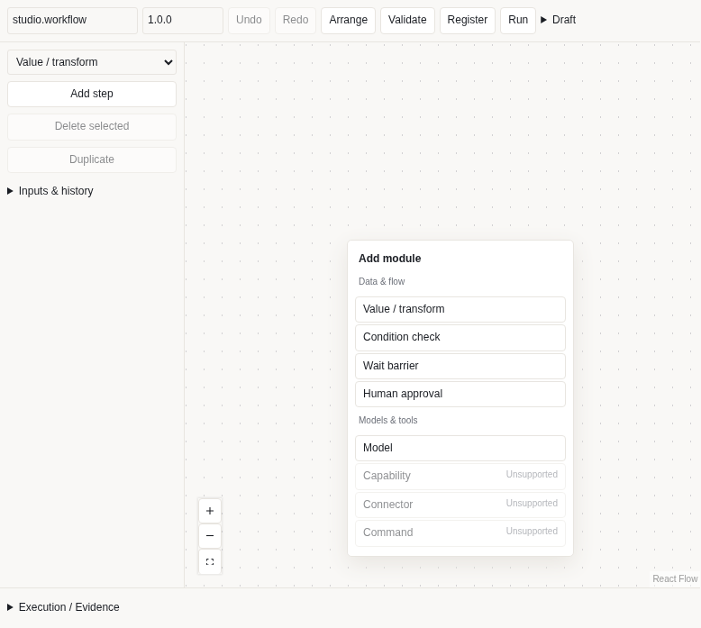
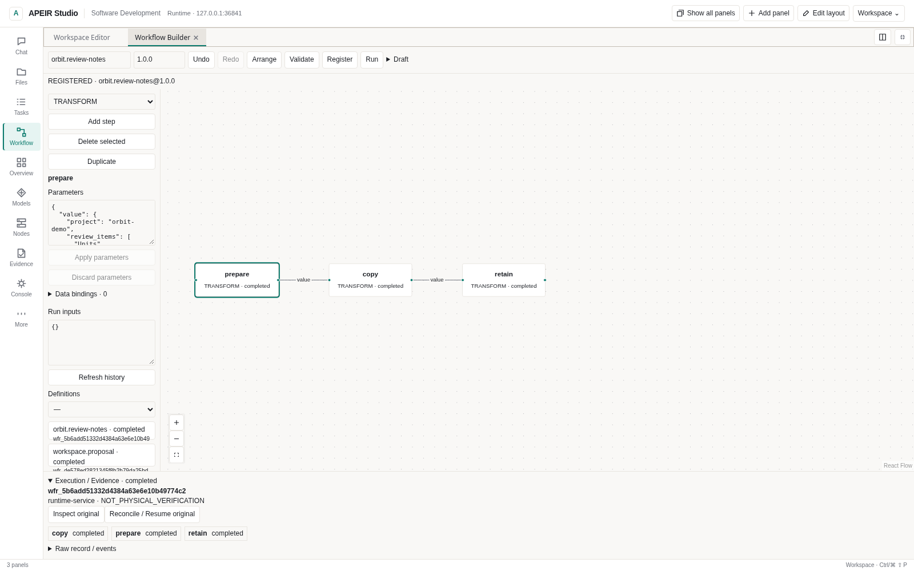

# Build and run a workflow

Use the Studio editor or the public CLI to register one definition, execute its
supported steps and inspect the original Run. Start with the model-free
[Hello Workflow](../../../examples/hello_workflow/README.md); model nodes have
additional account, budget, approval and Kernel prerequisites.

## Visual Workflow Builder

Choose **Add panel → Workflow Builder**. The graph edits the same
WorkflowDefinition used by the Compiler, WorkflowStore and public CLI.

Right-click an empty part of the canvas to add a module at that position. Keyboard
users can focus the canvas and press **Shift+F10**, then use arrows and Enter;
Escape closes the menu. The existing step selector and **Add step** button remain
available for touch and keyboard use. Unsupported handlers stay disabled.
Adding a node only edits the draft; it does not register, approve or execute it.

A value/transform node accepts plain text in **Value**. Choose **Apply parameters**
to accept the change. **Advanced parameters** retains the original JSON editor
for structured values and all existing parameters. **Inputs & history** contains
Run inputs, registered definitions and original Run records.

**中文提示：** 画布空白处右键可添加模块；触屏可使用左侧“添加节点”。常用内容
直接填写，高级参数与数据绑定按需展开。保存草稿、注册定义和运行仍是三个独立操作。



*Actual source-browser session against a model-disabled Runtime. The enabled
Model entry allows configuration; it does not prove inference is available.*

1. Add nodes, edit parameters and connect dependency handles. Shift-select,
   duplicate/delete, arrange, zoom and undo/redo are available.
2. **Apply parameters**, then **Validate** with the existing Compiler.
3. **Register** an immutable `workflow_id@version`. Change its version to change
   an already registered definition.
4. **Run** the reviewed version. Inspect its original Run, step outputs, digests
   and EventStream history. A lost response calls for history inspection, not
   another submission.

| Handler in the Studio API | Actual behavior |
| --- | --- |
| TRANSFORM | Returns `params.value` and the Run inputs |
| CONDITION | Compares `params.input` with `params.equals`; mismatch skips this node, without true/false branch ports |
| WAIT | Immediate barrier; not a timer |
| APPROVAL | Waits for a current authorized human on `workflow:RUN_ID:STEP_ID` |
| AGENT with `action: model.invoke` | One approved model turn through AgentSession, Gateway and NKI; explicit model and budgets required |
| Other AGENT / CAPABILITY / CONNECTOR / COMMAND | UNSUPPORTED here; no matching execution host is bound |

Arrows express dependencies. In **Data bindings**, select a target parameter,
the Run inputs or a direct dependency, and a JSON pointer such as `/value`.
**Bind input** explicitly replaces that target's literal parameter. Bound edges
show their target names; remove a binding before removing its dependency.
The version 1 `data_bindings` step contract holds input references and optional
per-step `inputs_schema` / `outputs_schema`. **Apply parameters** applies the
parameter and contract drafts together. The backend Compiler validates both.

Bindings read original persisted results, not canvas labels. Missing paths or
input-type mismatches stop before downstream dispatch. An invalid result retains
its original output and checkpoint; it does not authorize another attempt or
implicit compensation. Changed evidence remains UNKNOWN. Digests and source
references appear in **Raw record / events** without copying resolved values
into the binding manifest. Resolved parameters and accepted results are bounded to 96 KiB.
There are no executable expressions or external schema fetches.

Use the [result-binding example](../../../examples/hello_workflow/result-bindings.json)
with matching Runtime/Studio builds. Workflow catalog and CLI validation advertise
`data_bindings_versions: [1]`; older builds do not implement these fields.
The new UI does not run a bound definition against an older catalog.
Choose **Model** (marked **APPROVAL**) for a single model turn. Select the registered model
ID, enter its instruction, output Token limit and USD budget, then apply the
parameters. This uses the saved Provider and credential reference; it does not
copy a key into the graph. Native Anthropic Messages remains unsupported by the
frozen Worker. Real cloud/local inference still needs its own qualification.

Only `params.input` may receive a data binding on a model node. The selected
model, budget and instruction remain explicit. For JSON results, set
`params.response_schema`; the same local-only JSON Schema validator checks it.
A downstream node can bind `input` to `/structured_output` of its direct
dependency. Each model turn requires the original human step approval.

The Run/step binding derives one original request ID and AgentSession. Recovery
requires the original accounting and committed Kernel receipt. Missing records
leave UNKNOWN; restarting does not authorize another paid request. Model tool
calls are data, never file/command permission. Generic autonomous Agent execution
is not supplied by this single-turn adapter. Data contracts do not grant permission.
Unsupported imported steps retain their fields for inspection/export. Validation
alone does not establish an executable handler.

Optional `inputs_schema` applies before Run creation; `outputs_schema` validates
the final output object keyed by step ID. Empty schemas keep the existing
unrestricted-object contract. Installed JSON Schema Drafts 4/6/7/2019-09/2020-12
are supported, default 2020-12. References stay inside the submitted schema;
external schema/file fetching is disabled. Errors do not echo private values.
A result-schema failure preserves original completed steps and checkpoints,
reports FAILED and does not replay or automatically compensate them. Named
custom actions require a real host handler.

**Save draft** downloads a private version1 bundle with the definition and
separate canvas positions. **Export definition** omits coordinates and remains
CLI-compatible. **Import** confirms replacement of an unsaved draft. These files
may contain private parameters; review before sharing. Drafts survive panel
movement in memory, not browser restart. Export before closing. Controller
switching retires the draft rather than sending it to the new Controller.
Registered definitions and Run history persist through Runtime restart.

Mutation admission uses the actual server workspace, never a body-selected
target. Missing policy or human identity remains BLOCKED. Ordinary resume does
not approve anything. For an original Gate-bound approval, a trusted local owner
can inspect and approve it in the owning workspace:

```bash
apeir --no-intelligence approval show APPROVAL_ID --json
apeir --no-intelligence approval approve APPROVAL_ID
```

Replace the placeholder with the original pending ID, then retry only that
reviewed request. A service bearer cannot approve itself. Cancel/recover operates
on the original Run; UNKNOWN does not authorize replay of uncertain effects.
Records use `execution_scope=runtime-service`, not fabricated Kernel traversal.

Import [Hello Workflow](../../../examples/hello_workflow/README.md) or validate the
same exported definition with the public CLI:

```bash
apeir --no-intelligence workflow validate workflow.json --json
```




The image above shows a real three-step TRANSFORM workflow at
[Studio source `1b09be4`](https://github.com/untrod/apeir/commit/1b09be440019981c1d6800b77f191cd3d3d1e7f8),
captured in Linux Chromium on 2026-11-02. The steps transfer recorded review
notes; they do not perform model analysis or run project tests. Registration and
execution each received an independent local approval. This is source-browser
acceptance, not Windows installation acceptance.
